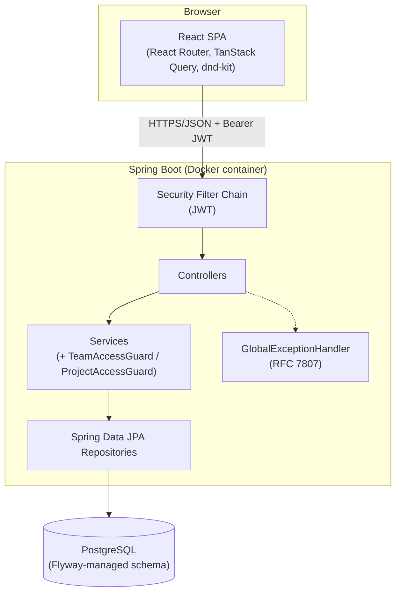
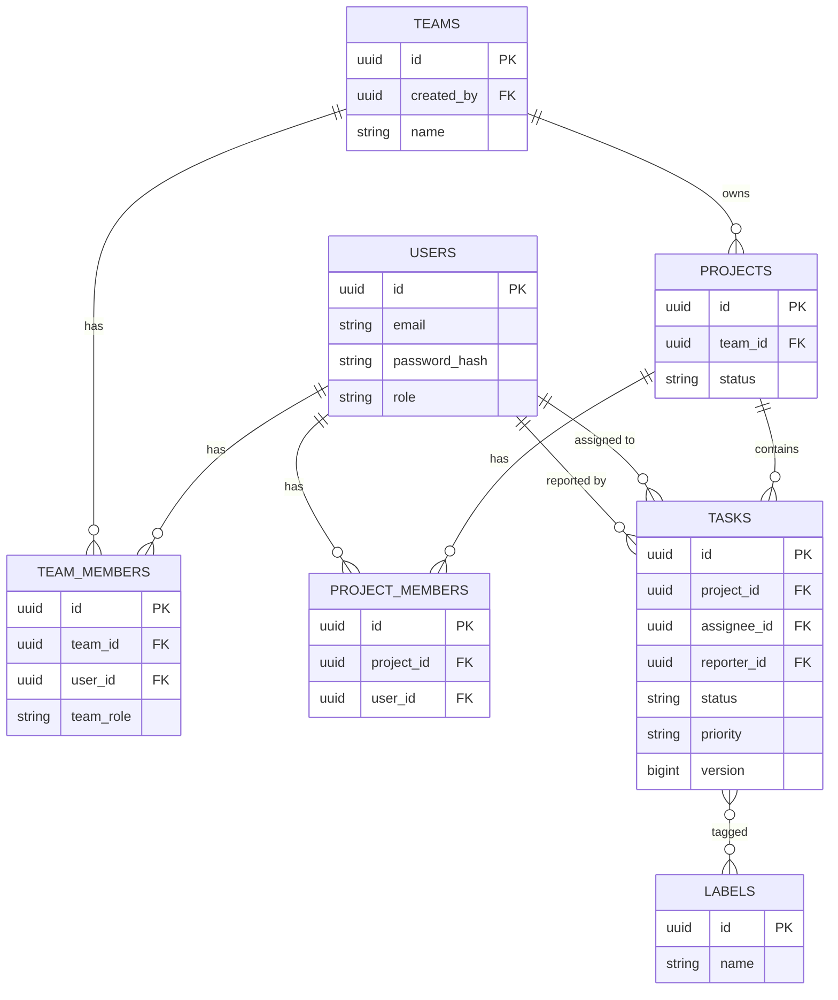
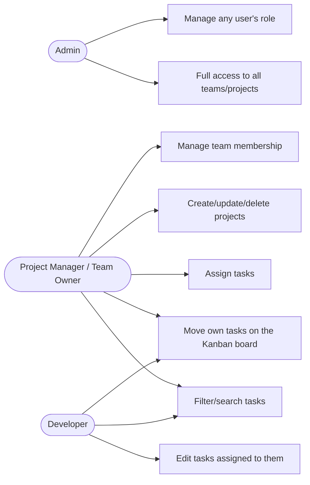
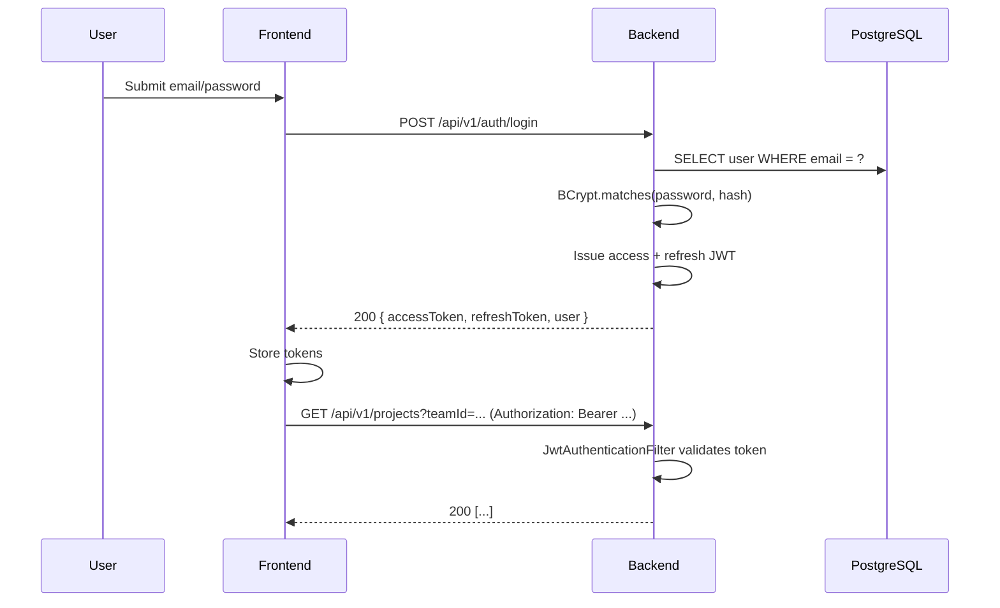
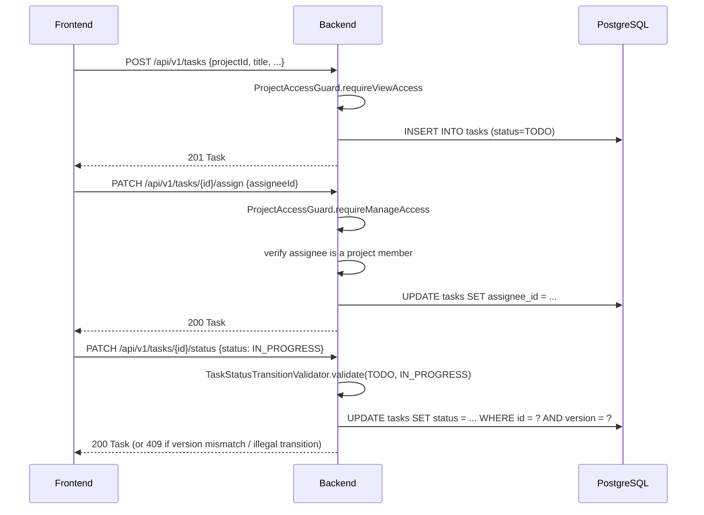
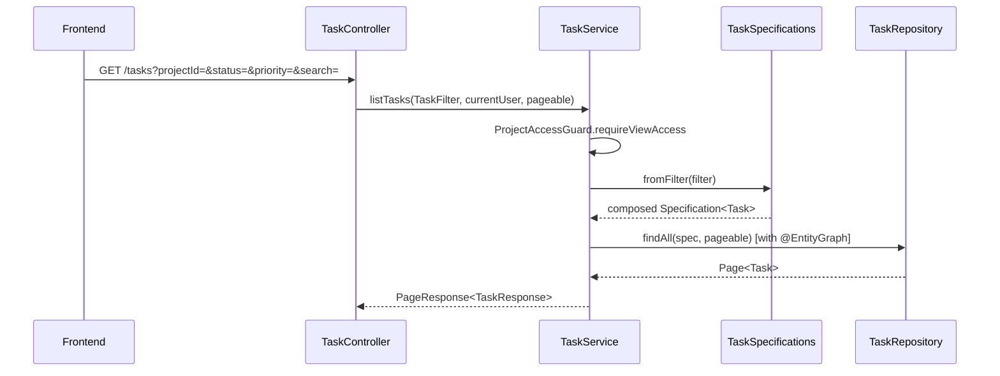

# Architecture

## 1. System architecture

Layered monolith, package-by-feature (`auth`, `user`, `team`, `project`, `task`, `dashboard`). No microservices, no message broker, no Kubernetes — deliberately, per the agreed scope: a single well-architected service demonstrates more engineering judgment for this project's purpose than distributed-systems machinery would.

## 2. Entity-relationship diagram

`comments`, `notifications`, and `activities` are intentionally absent — they ship as additive `V2`/`V3`/`V4` migrations only if the optional phase is built (see §5).

## 3. Use case diagram

## 4. Sequence diagrams

### Login → authenticated request

### Create task → assign → move on board

### Task filtering

## 5. Scope: Core vs optional

**Core (built)**: auth, users/roles, teams, projects, tasks + labels, filtering/search/sort/pagination, Kanban board, dashboard, resource-level authorization, unit tests, Swagger, Docker, CI/CD.

**Optional (not built, schema-ready)**: comments, notifications, activity history. These would arrive as `V2__add_comments.sql`, `V3__add_notifications.sql`, `V4__add_activity.sql` — never folded into `V1__init_schema.sql`, so the shipped schema stays honest about what's actually implemented.

## 6. Key decisions

- **DTOs everywhere, MapStruct for mapping** — entities never cross the service boundary.
- **`TeamAccessGuard` / `ProjectAccessGuard`** — resource-level authorization centralized once, reused by every service that touches team- or project-owned resources, instead of duplicated per service.
- **Three-tier task authorization**: view/create/move (any project member) < field-edit (assignee or manager) < assign/delete (manager only) — deliberately different bars for different actions, not a single role check.
- **`@EntityGraph` + `@BatchSize`** to avoid N+1 on task listing (see `TaskRepository`).
- **`@Version` optimistic locking** on `Task` for concurrent Kanban drags.
- **Flyway, not `ddl-auto`** — the schema is explicit, versioned, and reviewable.
