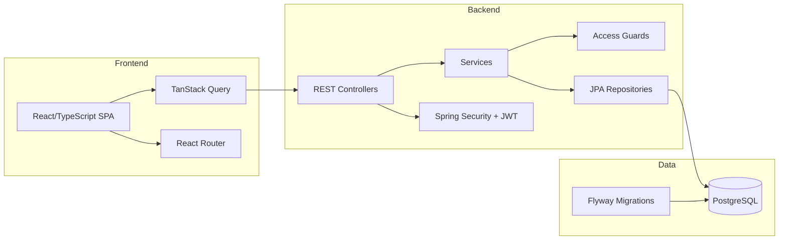

# TaskFlow

A media production project management platform (Jira/Trello-style) built as a Software Engineering portfolio project: JWT-secured Spring Boot API, PostgreSQL with Flyway migrations, a React/TypeScript frontend with a drag-and-drop Kanban board, Docker Compose, and a GitHub Actions CI pipeline.

## Features

- **Auth**: role-selecting registration, login/refresh, JWT access + refresh tokens, BCrypt password hashing, Producer user management and account activation
- **Teams**: create teams, manage membership, team-scoped roles (OWNER/MANAGER/MEMBER)
- **Projects**: team-scoped projects with unique codes, status, required start/target dates, membership, budgets and expense tracking
- **Tasks**: CRUD, dynamic filtering (status/priority/assignee/deadline range/search), pagination & sorting, labels, optimistic locking
- **Kanban board**: drag-and-drop between TODO → IN_PROGRESS → IN_REVIEW → DONE, with server-side transition validation (no skipping columns) and optimistic locking against concurrent drags
- **Task comments**: add, edit, and delete comments on tasks; authorization enforced server-side
- **Activity history**: audit trail of task and project actions (status changes, assignments, label changes, comments)
- **Notifications**: persistent notifications for task assignments, with unread count, mark-as-read, and mark-all-as-read
- **Dashboard**: per-project stats (totals, completion %, overdue, by status/priority) and a cross-project "my tasks" view
- **Authorization**: Producer, Content Manager and Team Member business roles, plus server-enforced team/project membership and task-assignment rules
- **API docs**: Swagger UI with JWT bearer auth wired in

## Tech stack

**Backend**: Java 21, Spring Boot 3.3, Spring Security, JWT (jjwt), Spring Data JPA, PostgreSQL, Flyway, MapStruct, Maven, springdoc-openapi, JUnit 5, Mockito, Testcontainers
**Frontend**: React 18, TypeScript, Vite, Tailwind CSS, React Router, TanStack Query, Axios, @dnd-kit, react-hook-form + zod, sonner
**DevOps**: Docker, Docker Compose, GitHub Actions

## Architecture



Layered backend (Controller → Service → Repository → PostgreSQL), package-by-feature, DTOs at every API boundary, MapStruct mapping, global `@RestControllerAdvice` exception handling (RFC 7807 `ProblemDetail`), JPA Specifications for dynamic task filtering, `@EntityGraph` + `@BatchSize` to avoid N+1 queries, `@Version` optimistic locking on tasks, Flyway-managed schema (no `ddl-auto`).

Resource-level authorization is centralized in two reusable guard components — `TeamAccessGuard` and `ProjectAccessGuard` — rather than duplicated per service. See `ARCHITECTURE.md` for diagrams and the full authorization matrix.

## Database overview

| Table | Purpose |
|-------|---------|
| `users` | Accounts with global roles (PRODUCER, CONTENT_MANAGER, TEAM_MEMBER) and active state |
| `teams` | Team workspace with creator reference |
| `team_members` | Team membership with roles (OWNER, MANAGER, MEMBER) |
| `projects` | Team-scoped projects with unique code, status, required dates, budget and currency |
| `project_expenses` | Project expense items with amount, category, date and creator |
| `project_members` | Project membership |
| `tasks` | Work items with status, priority, assignee, reporter, deadline, optimistic lock version |
| `labels` | Global labels with name and color |
| `task_labels` | Many-to-many between tasks and labels |
| `comments` | Task comments with author, content, timestamps |
| `activities` | Audit history of task/project actions |
| `notifications` | Persistent user notifications with read/unread state |

## Authentication / authorization

1. Register / login returns JWT access token (15 min) + refresh token (7 days)
2. Access tokens are sent in the `Authorization: Bearer` header
3. Refresh tokens are used to obtain new access tokens when the old one expires
4. Registration accepts one of the three defined business roles; Producers can manage user roles and account activation.
5. Resource-level guards (`TeamAccessGuard`, `ProjectAccessGuard`) enforce Producer privileges plus team membership and project access.
6. Team Members update only their assigned task statuses; Content Managers can approve or return tasks in review; Producers manage projects, teams, tasks and project finances.

## API documentation

Swagger UI is available at `http://localhost:8081/swagger-ui.html` when the backend is running.

Key endpoints:

| Method | Path | Description |
|--------|------|-------------|
| POST | `/api/v1/auth/register` | Register a new account |
| POST | `/api/v1/auth/login` | Login (returns tokens) |
| POST | `/api/v1/auth/refresh` | Refresh access token |
| GET | `/api/v1/auth/me` | Get current user |
| GET | `/api/v1/users` | Producer: list users |
| PATCH | `/api/v1/users/{id}/role` | Producer: change a user's role |
| PATCH | `/api/v1/users/{id}/enabled` | Producer: activate/deactivate an account |
| GET | `/api/v1/teams` | List teams |
| POST | `/api/v1/teams` | Create team |
| GET | `/api/v1/teams/{id}` | Get team |
| PATCH | `/api/v1/teams/{id}` | Update team |
| DELETE | `/api/v1/teams/{id}` | Delete team |
| GET | `/api/v1/teams/{id}/members` | List members |
| POST | `/api/v1/teams/{id}/members` | Add member |
| DELETE | `/api/v1/teams/{id}/members/{userId}` | Remove member |
| PATCH | `/api/v1/teams/{id}/members/{userId}/role` | Update member role |
| GET | `/api/v1/projects` | List projects (by team) |
| POST | `/api/v1/projects` | Create project |
| GET | `/api/v1/projects/{id}` | Get project |
| PATCH | `/api/v1/projects/{id}` | Update project |
| GET | `/api/v1/projects/{id}/finance` | View budget and expense summary |
| PATCH | `/api/v1/projects/{id}/budget` | Set project budget and currency |
| POST | `/api/v1/projects/{id}/expenses` | Record an expense |
| DELETE | `/api/v1/projects/{id}/expenses/{expenseId}` | Remove an expense |
| DELETE | `/api/v1/projects/{id}` | Delete project |
| GET | `/api/v1/projects/{id}/members` | List project members |
| POST | `/api/v1/projects/{id}/members` | Add project member |
| DELETE | `/api/v1/projects/{id}/members/{userId}` | Remove project member |
| GET | `/api/v1/tasks` | List tasks (filtered, paginated) |
| POST | `/api/v1/tasks` | Create task |
| GET | `/api/v1/tasks/{id}` | Get task |
| PATCH | `/api/v1/tasks/{id}` | Update task |
| DELETE | `/api/v1/tasks/{id}` | Delete task |
| PATCH | `/api/v1/tasks/{id}/status` | Move task (Kanban) |
| PATCH | `/api/v1/tasks/{id}/assign` | Assign task |
| POST | `/api/v1/tasks/{id}/labels/{labelId}` | Add label |
| DELETE | `/api/v1/tasks/{id}/labels/{labelId}` | Remove label |
| GET | `/api/v1/tasks/{id}/comments` | List comments |
| POST | `/api/v1/tasks/{id}/comments` | Add comment |
| PATCH | `/api/v1/tasks/{id}/comments/{commentId}` | Edit comment |
| DELETE | `/api/v1/tasks/{id}/comments/{commentId}` | Delete comment |
| GET | `/api/v1/activities/tasks/{taskId}` | List task activity |
| GET | `/api/v1/activities/projects/{projectId}` | List project activity |
| GET | `/api/v1/notifications` | List notifications |
| GET | `/api/v1/notifications/unread-count` | Get unread count |
| PATCH | `/api/v1/notifications/{id}/read` | Mark as read |
| POST | `/api/v1/notifications/mark-all-read` | Mark all as read |
| GET | `/api/v1/labels` | List labels |
| POST | `/api/v1/labels` | Create label |
| GET | `/api/v1/projects/{id}/dashboard` | Project dashboard |
| GET | `/api/v1/dashboard/my-tasks` | My tasks dashboard |

## Project structure

```
taskflow/
├── backend/                      Spring Boot API
│   ├── src/main/java/com/taskflow/
│   │   ├── config/               Security, OpenAPI
│   │   ├── security/             JWT, filters, principal
│   │   ├── auth/                 Authentication
│   │   ├── user/                 Users, roles
│   │   ├── team/                 Teams, members, guards
│   │   ├── project/              Projects, members, guards
│   │   ├── task/                 Tasks, labels, Kanban logic
│   │   ├── comment/              Task comments
│   │   ├── activity/             Activity/audit history
│   │   ├── notification/         Notifications
│   │   ├── dashboard/            Stats aggregation
│   │   ├── expense/              Project budgets and expense records
│   │   └── common/               DTOs, exceptions
│   └── src/main/resources/
│       └── db/migration/         Flyway SQL migrations (V1-V8)
├── frontend/                     React/TypeScript SPA
│   └── src/
│       ├── api/                  Axios client, endpoint modules
│       ├── components/           Shared UI kit
│       ├── context/              Auth context
│       ├── features/             Pages (auth, dashboard, teams, projects, board)
│       └── lib/                  Types, constants
├── .github/workflows/ci.yml
├── docker-compose.yml
├── .env.example
├── README.md
├── ARCHITECTURE.md
├── API.md
└── CONTRIBUTING.md
```

## Running locally

### Prerequisites

- JDK 21
- Node.js 20
- PostgreSQL 16 (or use Docker Compose)
- Docker & Docker Compose (optional)

### With Docker (recommended)

```bash
cp .env.example .env
# edit .env: set DB_PASSWORD and JWT_SECRET (e.g. `openssl rand -base64 64` for the secret)
docker compose up --build
```

- Frontend: http://localhost:5173
- Backend API: http://localhost:8081/api/v1
- Swagger UI: http://localhost:8081/swagger-ui.html

### Without Docker

**Backend** (requires a local PostgreSQL and JDK 21):
```bash
cd backend
export DB_URL=jdbc:postgresql://localhost:5432/taskflow
export DB_USERNAME=taskflow
export DB_PASSWORD=taskflow
export JWT_SECRET=$(openssl rand -base64 64)
mvn spring-boot:run
```

**Frontend** (requires Node 20):
```bash
cd frontend
npm install
npm run dev
```

### Local test data

The default `dev` profile loads repeat-safe demo data from `backend/src/main/resources/db/dev-migration/R__dev_seed_data.sql` through Flyway. It creates a sample team, two projects, tasks across all workflow statuses, comments, notifications, activity/history, labels, and expenses. The seed is not enabled by the default Docker profile.

To load the same demo data with Docker Compose, opt into both profiles:

```bash
SPRING_PROFILES_ACTIVE=docker,dev docker compose up --build
```

All seeded accounts use the password `Taskflow123!`:

| Role | Email |
|------|-------|
| Producer / team owner | `producer@test.taskflow.local` |
| Producer / team manager | `manager@test.taskflow.local` |
| Content Manager | `content@test.taskflow.local` |
| Team Member | `member@test.taskflow.local` |

These are local testing credentials only. Do not enable the `dev` profile in a production deployment. Seed inserts are idempotent and do not reset records that already exist.

## Environment variables

| Variable | Default | Description |
|----------|---------|-------------|
| `DB_URL` | `jdbc:postgresql://localhost:5432/taskflow` | PostgreSQL JDBC URL |
| `DB_USERNAME` | `taskflow` | Database user |
| `DB_PASSWORD` | `taskflow` | Database password |
| `JWT_SECRET` | (required) | HMAC secret (≥32 bytes) |
| `JWT_ACCESS_EXPIRATION_MS` | `900000` | Access token TTL (15 min) |
| `JWT_REFRESH_EXPIRATION_MS` | `604800000` | Refresh token TTL (7 days) |
| `CORS_ALLOWED_ORIGINS` | `http://localhost:5173` | Allowed CORS origins |
| `VITE_API_BASE_URL` | `http://localhost:8081/api/v1` | Frontend API target |

## Testing

```bash
cd backend
mvn test          # unit tests (Mockito) - fast, no external services
mvn verify         # + AuthIntegrationTest, which spins up a real Postgres via Testcontainers (needs Docker)
```

```bash
cd frontend
npm run build      # type-checks (tsc -b) and builds
```

## CI/CD

`.github/workflows/ci.yml` runs on every push/PR to `main`:
- **Backend**: JDK 21, `mvn clean verify` (compiles + full test suite including Testcontainers)
- **Frontend**: Node 20, `npm ci && npm run build`

Both must pass before merging.

## Default accounts

There are no seeded accounts — register through `POST /api/v1/auth/register` (or the UI) and choose Producer, Content Manager, or Team Member. Registration is intentionally open and role-selectable, as requested for this project.

## Known limitations

- **Team membership lookup uses an exact email address**; there is no user-search/picker endpoint yet.
- **Kanban board only supports cross-column moves**, not within-column reordering.
- **Frontend has no automated test suite** (Vitest/RTL) yet — verification is the real `tsc` type-check + `vite build`.

## Future improvements

- User search by email for team member invitations
- Within-column task ordering
- Email notifications for deadlines and mentions
- Real-time updates via WebSockets
- File attachments on tasks and comments
- Frontend test suite (Vitest + React Testing Library)
- Dark mode support

## Documentation

- [`ARCHITECTURE.md`](./ARCHITECTURE.md) — diagrams (architecture, ERD, use case, sequence), authorization matrix, key decisions
- [`API.md`](./API.md) — endpoint reference
- [`CONTRIBUTING.md`](./CONTRIBUTING.md) — branch/commit conventions
